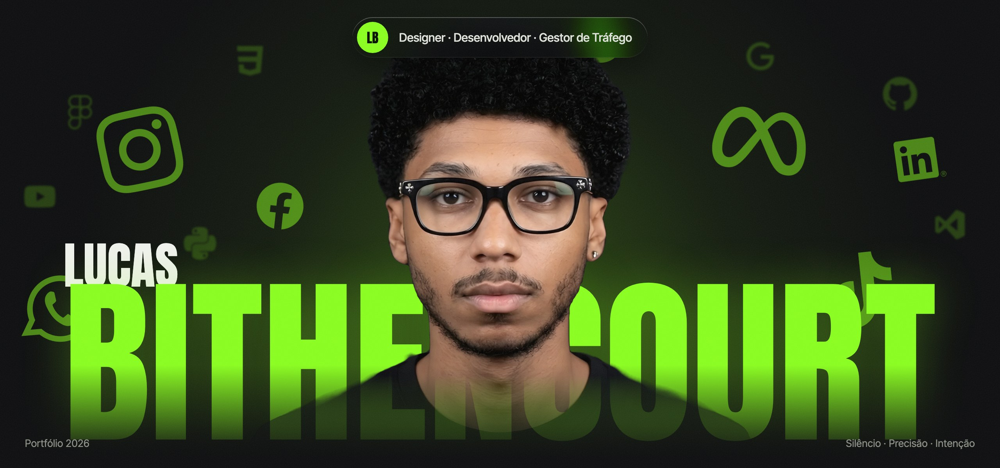
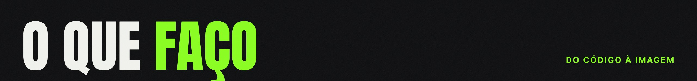
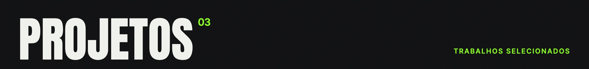
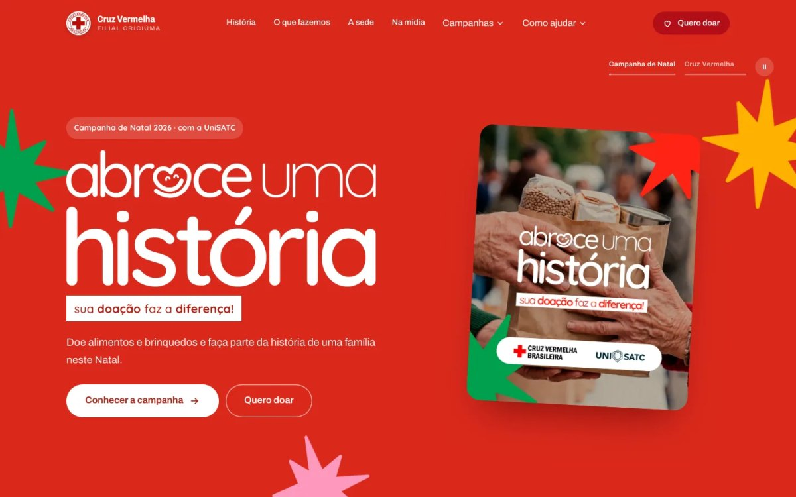
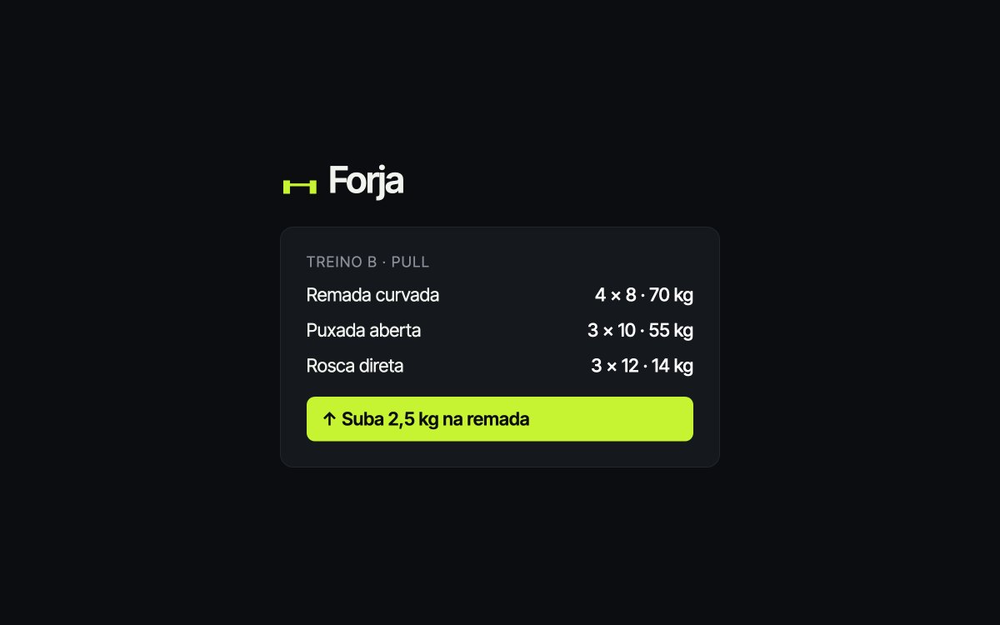
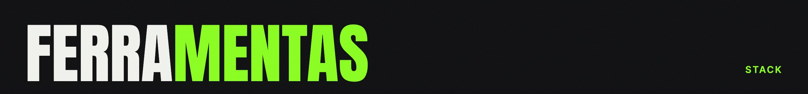
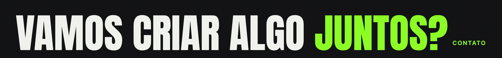

  
  
  
  

  <b>Crio experiências digitais com intenção, do código à imagem.</b> 
  Uno design, programação e estratégia digital para construir soluções modernas, funcionais e com foco em resultado.

| | |
|:--|:--|
| **01 · Desenvolvimento Web**   Sites e sistemas vivos: landing pages, apps e painéis, do layout ao banco de dados. | **02 · Tráfego Pago**   Dados que viram resultado: campanhas na Meta, verba e relatórios. |
| **03 · Social Media**   Movimento que para o feed: carrosséis, stories e vídeos curtos. | **04 · Branding**   Símbolos que ficam: identidade visual, logo e linguagem da marca. |
| **05 · Motion Design**   A marca em movimento: animações para web, vídeo e redes. | **06 · Impressos**   O toque do físico, com a mesma identidade do digital. |

<table>
  <tr>
    <td width="33%" valign="top">
      
       <b>Cruz Vermelha Criciúma</b>
       Site institucional · Projeto Integrador UniSATC
       HTML · CSS · JS · GSAP · Supabase · Leaflet
       <a href="https://lucasbithencourt.github.io/cruz-vermelha-criciuma/">Ver site ↗</a> · <a href="https://github.com/Lucasbithencourt/cruz-vermelha-criciuma">Código ↗</a>
    </td>
    <td width="33%" valign="top">
      
       <b>Forja Treino</b>
       App de treino · PWA
       React · TypeScript · Vite · Supabase
       <a href="https://forja-six-psi.vercel.app">Abrir app ↗</a>
    </td>
    <td width="33%" valign="top">
      
       <b>Mony Modas</b>
       Site institucional · Varejo
       HTML · CSS · JS · SEO local
       <a href="https://monymodas.vercel.app">Ver site ↗</a>
    </td>
  </tr>
</table>

  
  
  
  
  
  
  
  
  
  
  
  
  
  
  

  <a href="mailto:lucasbithencourt2005@gmail.com"><b>lucasbithencourt2005@gmail.com ↗</b></a>
    
  
  
  

 

  <picture>
    <source media="(prefers-color-scheme: dark)" srcset="https://raw.githubusercontent.com/Lucasbithencourt/Lucasbithencourt/output/snake-dark.svg">
    
  </picture>

Silêncio · Precisão · Intenção

